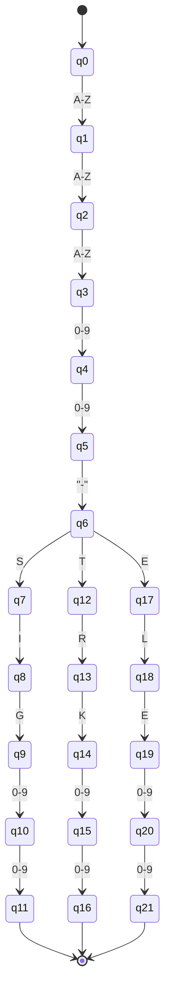

# Part A – DFA and Regular Expression (BCS503)

**Report ID format:** `STATION-CODE` + `-` + `INCIDENT-CODE`, e.g. `ABC12-SIG01`

**Regex:** `^[A-Z]{3}[0-9]{2}-(SIG|TRK|ELE)[0-9]{2}$` (applied with `re.fullmatch`)

**DFA** M = (Q, Σ, δ, q0, F): Q = {q0…q21, qT}, Σ = A–Z, 0–9, `-`, q0 = start, **F = {q11, q16, q21}**.
Every unspecified transition goes to the single trap state **qT**, which loops on every symbol and is not accepting.

(All other inputs from any state, and any extra input after q11/q16/q21, go to qT.)

| State | Expected input | Next |
|---|---|---|
| q0, q1, q2 | A–Z | q1, q2, q3 |
| q3, q4 | 0–9 | q4, q5 |
| q5 | `-` | q6 |
| q6 | S / T / E | q7 / q12 / q17 |
| q7, q8 | I, G | q8, q9 |
| q9, q10 | 0–9 | q10, q11 (final, SIG) |
| q12, q13 | R, K | q13, q14 |
| q14, q15 | 0–9 | q15, q16 (final, TRK) |
| q17, q18 | L, E | q18, q19 |
| q19, q20 | 0–9 | q20, q21 (final, ELE) |
| q11, q16, q21 | any further symbol | qT |
| qT | any | qT |

Implementation: `dfa_validate()` and `regex_validate()` in `app.py`; comparison + 56,000-string fuzz test in `part_a_demo.py`.

## Classification (exactly five categories) and priority rule
1. description contains the word *test* → **Test-Entry**
2. description contains *minor delay* → **Minor-Delay**
3. prefix SIG → **Signal-Failure**, TRK → **Track-Obstruction**, ELE → **Electrical**

Deterministic order: Test-Entry → Minor-Delay → prefix. Invalid or unsupported identifiers are rejected (with a reason) and never receive a category.
